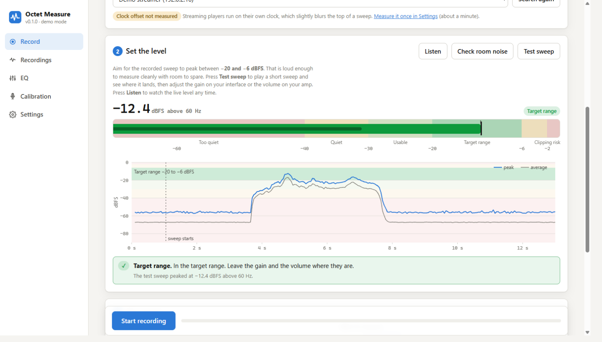
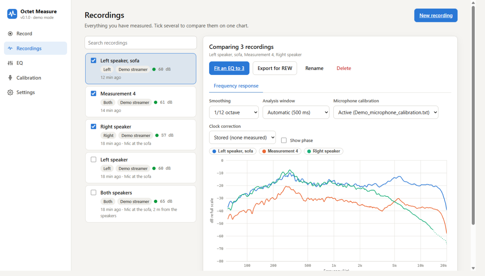
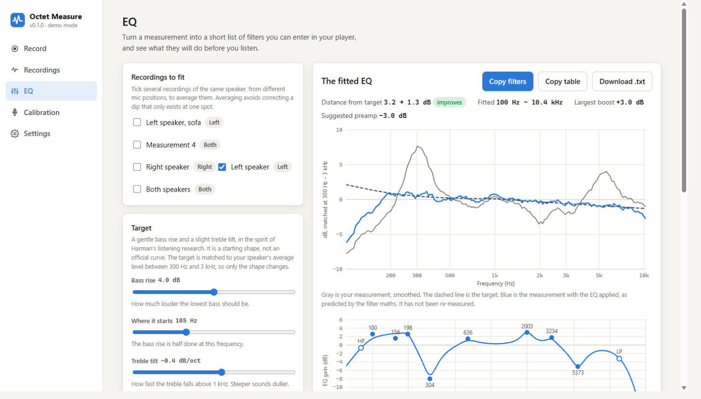
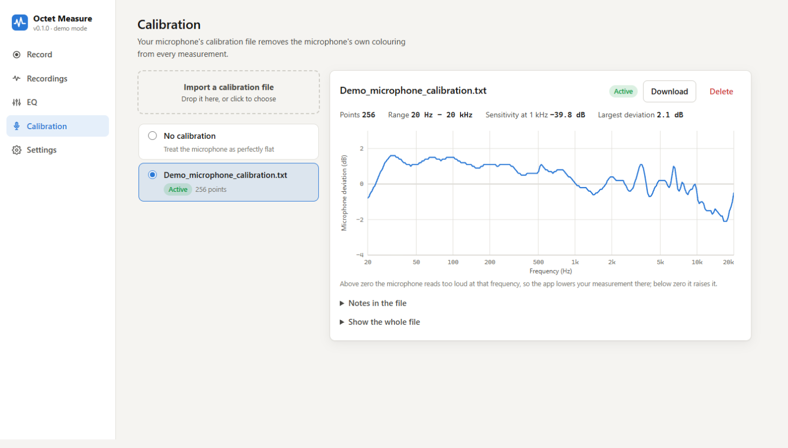

# Octet Measure

**Phase 2: [Auto Tune](docs/AUTO_TUNE.md)** measures eight individual drivers on
the Pi, searches crossovers, fits driver and room EQ, and exports and verifies a
CamillaDSP configuration. Control it from the **Auto Tune** page in the existing
browser app. Try `octet-measure ui --demo`, or
`octet-measure auto start --demo --unattended`.

Measure how a loudspeaker really behaves, then turn the measurement into a short list of EQ filters. It runs in your browser, on your own computer, with a measurement microphone and any player you like.



- **Record** a swept-sine measurement through any speaker. A live level meter shows the range your recording should land in, so you set the gain right the first time.
- **Recordings** shows the frequency response, impulse response and signal-to-noise ratio of everything you have measured, and overlays several to compare.
- **EQ** fits up to ten parametric filters toward a gentle, Harman-style target, shows what they will do, and gives you the numbers to type into your player.
- **Calibration** keeps your microphone's calibration file, which removes the microphone's own colouring from every result.
- Works with a **WiiM or any DLNA/UPnP streamer**, with sound from **this computer**, or with **anything else** (play the sweep file yourself).
- Exports **REW-importable** files for use in Room EQ Wizard.





The microphone's calibration file, and what it corrects:



## Install

You need Python 3.10 or newer. Get the code and install it:

```
git clone <this repository>
cd octet/measure
pipx install .                      # or: pip install .
octet-measure                       # opens the app in your browser
```

If the package is published on PyPI, `pipx install octet-measure` does the same.

To look around before you connect anything, run `octet-measure ui --demo`. It uses a simulated microphone, speaker and player.

| System | Notes |
|---|---|
| **Windows** | Works as is. The first time the app plays a sweep to a network player, Windows may ask whether to let it through the firewall: allow it on private networks. |
| **macOS** | Allow your terminal to use the microphone when macOS asks (System Settings, Privacy and Security, Microphone). |
| **Linux** | Needs the PortAudio library: `sudo apt install libportaudio2` (Debian, Ubuntu) or your distribution's equivalent. |

For the plots made by the command line, add the extra: `pip install "octet-measure[plots]"`. The browser app does not need it.

## What you need

- A **measurement microphone** with a calibration file for your serial number, plugged into a sound card or interface.
- Something to play the sweep: a network streamer, this computer's sound card, or any player.
- A quiet room. The app tells you how quiet it is.

## How a measurement goes

1. **Microphone and player.** Choose your input and how the sweep will be played.
2. **Set the level.** Press *Test sweep*. The meter shows where the sweep landed against the target range of −20 to −6 dBFS, and says what to change. Repeat until it is in range.
3. **Record.** Name it and press *Start recording*. It takes about half a minute.
4. **Look.** Open the recording, then *Fit an EQ* to get filters.

A clean sweep gives you the speaker's response in the room. A DML or any panel speaker is better measured at several positions and averaged: tick several recordings in the EQ page.

## Things worth knowing

- **Clock offset.** A network player and your microphone interface run on slightly different clocks, usually by a few tens of parts per million. That is inaudible in music, but it blurs the top of a sweep a little. *Settings* can measure the difference once, with a steady tone, and the analysis then corrects for it.
- **The target is not official.** There is no single numeric "Harman in-room target". The one here, a gentle bass rise and a slight treble tilt, is a sensible starting shape. You can change it.
- **Levels are relative** to digital full scale, not calibrated sound pressure.
- **The EQ is a prediction** until you re-measure with the filters switched on.
- Everything stays on your computer. The app only listens on your own machine unless you start it with `--host 0.0.0.0`.

## Command line

Everything the app does is also a command. `octet-measure --help` lists them; the main ones:

```
octet-measure ui [--demo] [--port 8765]        # the browser app
octet-measure devices                          # list audio devices
octet-measure renderers                        # find network players
octet-measure clock --play-dlna wiim --save    # measure the player's clock offset
octet-measure record "Left speaker" --play-dlna wiim --fs 44100 --cal mic.txt
octet-measure peq "Left speaker" --cal mic.txt # fit EQ filters
octet-measure export "Left speaker" --cal mic.txt   # files REW can import
```

Your recordings are kept in `~/OctetMeasure/measurements`. Set `OCTET_DATA` to use another folder.

## Troubleshooting

- **No input device found.** Connect the microphone or interface and reload. On Linux, install PortAudio (see above). On macOS, allow microphone access.
- **The network player is not listed.** Check it is on and on the same network as this computer. Guest networks and some routers isolate devices from each other.
- **The player never fetched the sweep.** Allow the app through the firewall on private networks.
- **The meter shows a high level when the room is silent.** Low-frequency rumble can dominate a plain meter. The app shows the level above 60 Hz, which is what counts, and a small tick for the plain peak.

## Development

```
git clone <this repository> && cd octet/measure
python -m venv .venv && .venv/bin/pip install -e ".[dev,plots]"      # on Windows: .venv\Scripts\pip
python -m pytest                      # no hardware needed: the tests use a simulated microphone
octet-measure ui --demo               # try changes against simulated hardware
```

The browser app is plain JavaScript with no build step: edit `octetmeasure/ui/static` and reload. `tools/` holds scripts used to check the analysis against independent methods.

## Licence

MIT. See `LICENSE`.
